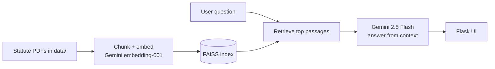

# Verdict AI

A local Flask demo of retrieval-augmented question answering over Indian legal texts. It
indexes statute PDFs, retrieves relevant passages with FAISS, and answers with Google
Gemini using LangChain.

> **Not legal advice.** This is a learning project. Answers can be wrong or incomplete and
> have not been reviewed by a lawyer. Consult a qualified professional for legal matters.

## Features

- **Chat (`/chat`, `POST /ask`):** ask a question and get an answer grounded in retrieved passages.
- **Summarize (`/summarize`):** summarize pasted legal text.
- **Local index:** statute PDFs are chunked and embedded once, then stored as a FAISS index.

## Architecture



## Setup

Requires Python 3.9+ and a [Google AI Studio API key](https://aistudio.google.com/apikey).

```bash
git clone https://github.com/sachin2967/verdict-ai.git
cd verdict-ai
python -m venv .venv && source .venv/bin/activate   # Windows: .\.venv\Scripts\Activate.ps1
pip install -r requirements.txt
cp .env.example .env        # then set GOOGLE_API_KEY
python run.py               # http://127.0.0.1:5000
```

### Docker

```bash
docker build -t verdict-ai . && docker run --env-file .env -p 5000:5000 verdict-ai
```

## Data and index

`data/` holds the source PDFs (Constitution of India, IPC, CrPC and related statute texts).
On first run the app builds the FAISS index into `nyaysaathi_faiss_index/`; later runs load
it from disk. To rebuild after changing the PDFs, delete that folder and restart.

The index is loaded with `allow_dangerous_deserialization=True` because LangChain stores
metadata with pickle. **Only load indexes you built yourself**; never accept index files
from untrusted sources.

## Project structure

| Path | Role |
| --- | --- |
| `run.py` | Entry point |
| `app/__init__.py` | Application factory, initializes the RAG service |
| `app/routes.py` | Web endpoints |
| `app/services.py` | `RAGService`: ingestion, retrieval, generation |
| `app/templates/`, `app/static/` | Frontend |
| `data/` | Source PDFs |

## Limitations

- No evaluation set: retrieval quality and answer accuracy have not been measured.
- No citation display, authentication or rate limiting; run locally only.
- Depends on the Google Gemini API; usage may incur cost and is subject to Google's terms.
- Statute texts may be outdated relative to current law.

## License

MIT for the code. The legal PDFs are public documents with their own terms.
